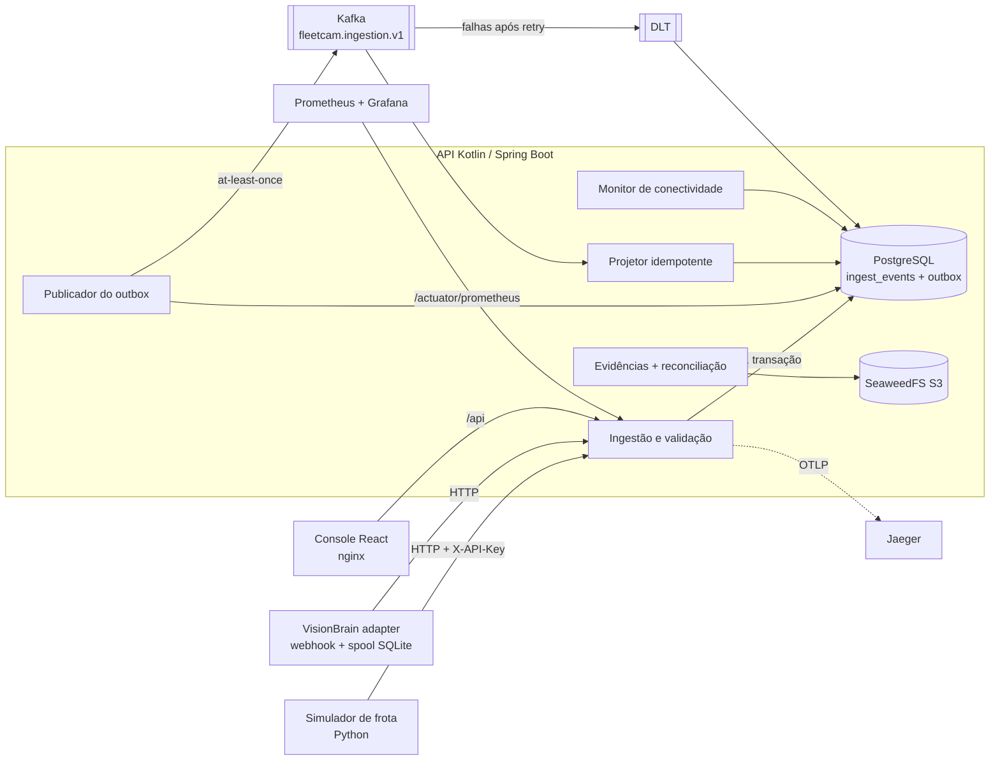
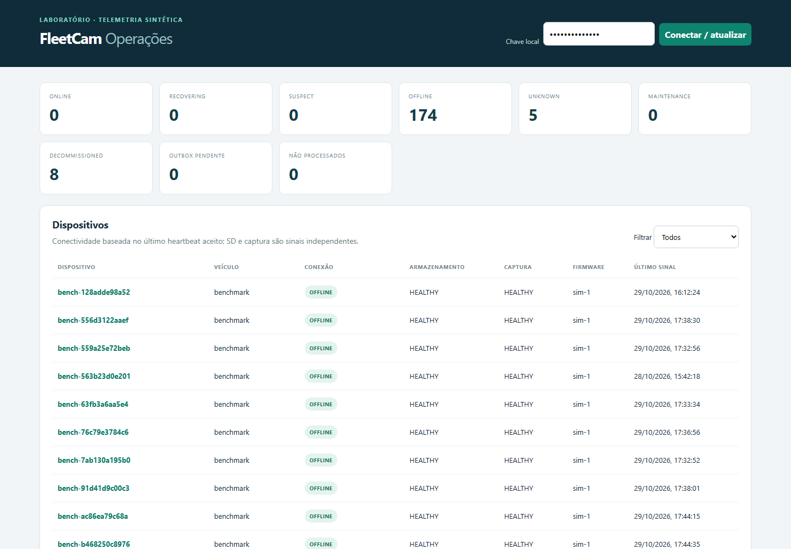
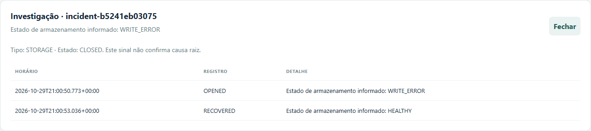
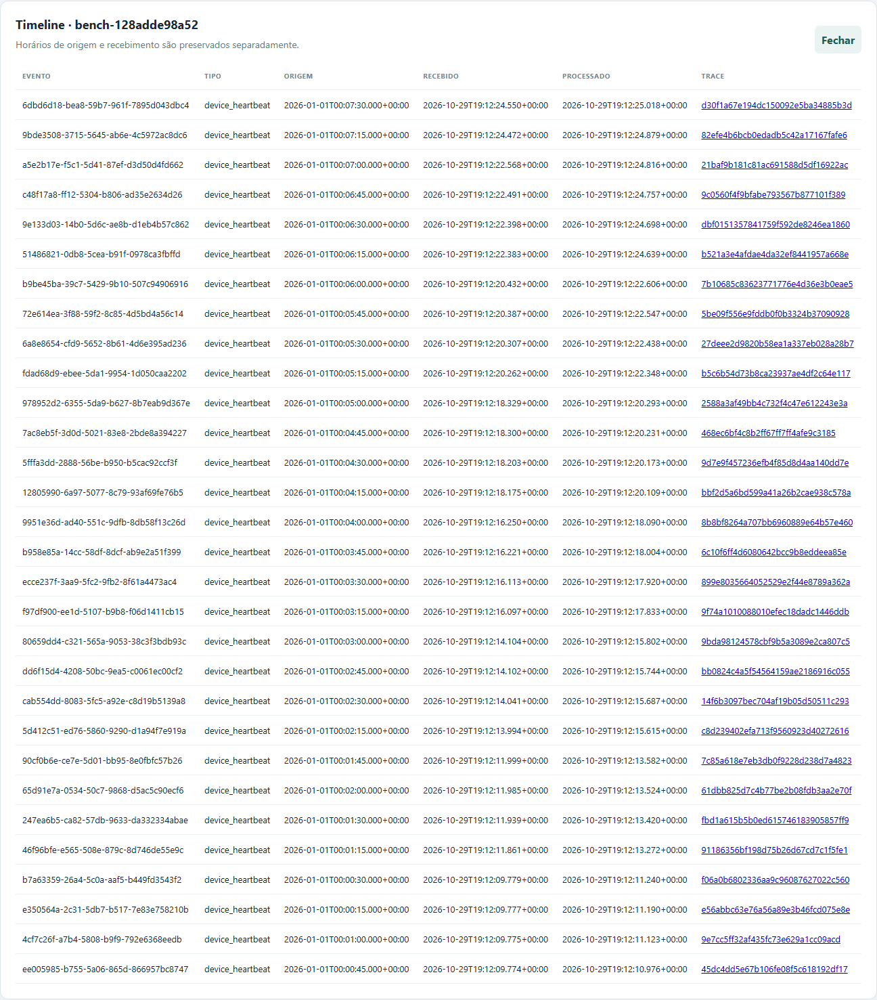
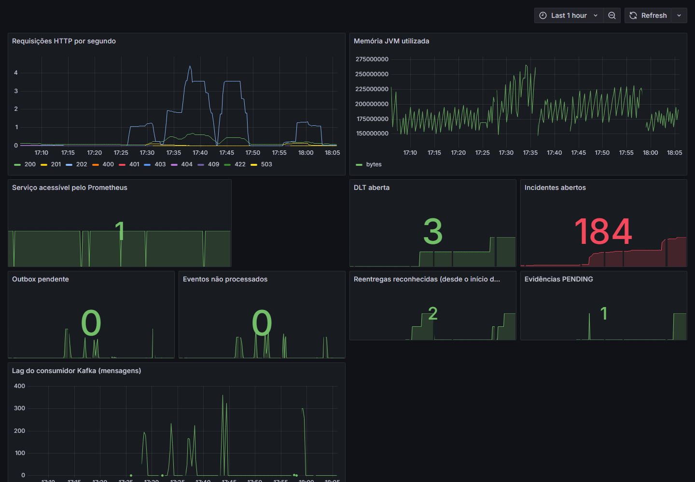
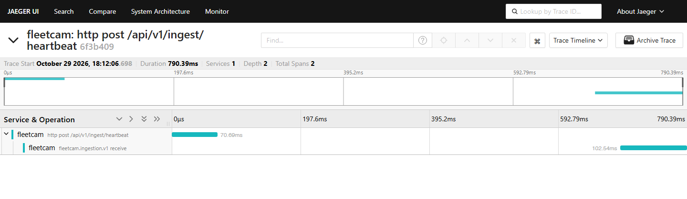

# 📹 FleetCam — laboratório de telemetria, incidentes e evidências para câmeras de frota

### Kotlin · Spring Boot 3 · Kafka · PostgreSQL · Flyway · SeaweedFS (S3) · React · Python · Prometheus · Grafana · OpenTelemetry/Jaeger · Testcontainers · Docker Compose

[](https://github.com/Yuri-Fernando/FleetCam-IoT-Video-Platform/actions/workflows/ci.yml)

-0a8a0a)


## 🟡 Status

**MVP técnico funcional — núcleo M0–M5 validado localmente.** Ingestão at-least-once com outbox, projeção idempotente, DLT/redrive auditado, saúde de dispositivo com incidentes, evidências S3 com integridade e reconciliação de upload interrompido, tracing ponta a ponta e métricas com alertas. Evidência: 17 checks de integração contra o Compose real, 3 testes Kotlin (um com Testcontainers), 3 testes Python, um crash SIGKILL com 300 eventos projetados uma única vez e um benchmark antes/depois com causa raiz medida. **Ainda não:** execução remota do CI comprovada, benchmark com vários devices/instâncias, autenticação por dispositivo, vídeo contínuo e hardware físico.

| Área | Estado | Evidência |
|---|---|---|
| Ingestão, outbox e Kafka | ✅ | `integration_check`, `fault_check`, `crash_check`, `RedeliveryTest` |
| Saúde de device e incidentes | ✅ | `incident_check`, `connectivity_check`, `reboot_check`, `lifecycle_check` |
| DLT e redrive | ✅ | `dlt_check`, `redrive_check` |
| Evidências S3 | ✅ | `evidence_check`, `evidence_reconcile_check` |
| Observabilidade | ✅ | `tracing_check`, `promtool` (5 regras), Grafana (10 painéis via API) |
| Desempenho | 🟡 | [benchmark](docs/benchmark.md): um host, um device |
| Integração VisionBrain | 🟡 | `adapters/visionbrain_check.py` (depende do projeto vizinho) |
| CI remoto | ⏳ | workflow incluído; resultado depende do primeiro push |

---

## Descrição / Contexto

FleetCam é um **laboratório de engenharia de backend e confiabilidade** para a cadeia operacional de câmeras embarcadas em veículos: o dispositivo envia heartbeats e eventos, o backend aceita, persiste, distribui por Kafka, projeta o estado de saúde de cada câmera, abre e fecha incidentes, guarda evidências (imagens) com integridade verificada e expõe tudo a um console de operação, métricas, traces e SQL de investigação.

O foco não é visão computacional. É o que acontece **entre** a câmera e o operador quando as coisas falham: broker fora do ar, processo morto no meio do processamento, mensagem duplicada, evento atrasado, cartão SD com erro de escrita, câmera sem sinal, upload de imagem interrompido. Cada uma dessas falhas tem um teste que a provoca de verdade no ambiente Compose e verifica o resultado no banco.

Toda a frota é **sintética**: não há dados reais, cliente, integração comercial, firmware proprietário nem hardware físico. Eventos simulados carregam `simulated: true` e origem explícita do começo ao fim.

---

## 🧭 Origem do Projeto

O projeto começou com um documento de escopo próprio (não versionado) que auditou meus repositórios públicos e cruzou o que eles já demonstravam com o que um posto de backend para vídeo embarcado exige. As conclusões que definiram o FleetCam:

1. O portfólio já mostrava visão computacional ([VisionBrain](https://github.com/Yuri-Fernando/VisionBrain), [VisionGuard](https://github.com/Yuri-Fernando/OOP_Project)), câmera física ([Iot_esp32cam](https://github.com/Yuri-Fernando/Iot_esp32cam)) e observabilidade ([RealTime-ML-Inference-Lab](https://github.com/Yuri-Fernando/RealTime-ML-Inference-Lab)), mas **não** um serviço central em Kotlin/Spring + Kafka responsável por saúde de devices, incidentes e evidências. Essa era a lacuna.
2. **Monólito modular primeiro.** Um único serviço Spring Boot com módulos de domínio; separar deploy só quando houver motivo medido. Nada de oito microsserviços e Kubernetes num laboratório.
3. **O simulador é a peça central**, não um acessório: falhas reproduzíveis com seed, manifesto e ground truth valem mais que um modelo de IA difícil de validar.
4. **Não inferir mais do que o device reporta.** Campo ausente é `UNKNOWN`; incidente é hipótese operacional, não diagnóstico de causa raiz; "broker atrasado" nunca vira "câmera offline".
5. **VisionBrain como engine opcional** atrás de um adapter: desligá-lo não pode afetar a saúde dos devices.
6. **Marcos com gates de evidência** (M0–M5), cada um com uma condição de "não avançar se…".

| Marco | Gate de aceitação (resumo) | Estado |
|---|---|---|
| M0 — contratos e decisões | outro dev entende como falha vira incidente e como evento atrasado é processado | ✅ contrato v1, ADRs, ameaças |
| M1 — Kotlin + Kafka + Postgres | 20 devices ONLINE; replay não duplica; crash/redelivery provado; sem perda quando Kafka cai | ✅ local · ⏳ CI remoto |
| M2 — saúde e falhas controladas | falhas nomeadas com ground truth; DLT recuperável; offline ≠ broker atrasado | 🟡 8 cenários; ground truth parcial |
| M3 — evidência e observabilidade | upload interrompido reconciliado; evento nunca aponta para evidência não confirmada; dashboards comparados ao banco | ✅ |
| M4 — VisionBrain e console | mesmo `event_id` atravessa o adapter; console mostra origem; URL assinada | 🟡 jornadas principais |
| M5 — RCA, desempenho, docs | demo com comando único; p95/p99 e lag medidos; antes/depois | ✅ local, um host |

---

## 🎯 Objetivo

- Aceitar eventos de câmera com contrato versionado e responder `202` **somente após persistir** evento e outbox na mesma transação.
- Garantir que nenhum evento aceito se perca quando o Kafka cai ou o processo morre, e que reentregas não repitam efeito no banco.
- Projetar o estado de cada dispositivo em dimensões independentes (conectividade, armazenamento, captura) e abrir/fechar incidentes com timeline.
- Separar explicitamente **sinal da câmera**, **backlog de publicação** e **lag do consumidor**.
- Guardar evidências em S3 com tamanho, SHA-256 e assinatura de arquivo verificados, acesso por URL assinada de curta duração, retenção e reconciliação de uploads abandonados.
- Ligar uma requisição HTTP ao outbox, ao Kafka e ao trace no Jaeger.
- Medir desempenho com origem declarada e investigar gargalos com hipóteses testadas.

---

## 🔬 Linha de Pesquisa / Desenvolvimento

- **Sistemas distribuídos:** transactional outbox, entrega at-least-once, idempotência por identidade e hash canônico, DLT com redrive auditado, ordenação por `boot_id`/`sequence_number`.
- **Diagnóstico de dispositivos:** máquinas de estado com histerese configurável (SD: 10%/12% de capacidade, dois aumentos de erro para abrir e duas leituras estáveis para fechar), sessões de boot, ciclo de vida PROVISIONED → ACTIVE → MAINTENANCE → DECOMMISSIONED.
- **Cadeia de evidência:** upload por URL pré-assinada, cópia verificada imutável, reconciliação de upload interrompido, retenção.
- **Observabilidade e RCA:** Micrometer/Prometheus, OpenTelemetry → Jaeger, alertas, SQL investigativo, runbook.
- **Engenharia de desempenho:** benchmark reproduzível, percentis, lag, investigação por experimento.
- **Multi-tenant de laboratório:** duas chaves vinculadas a tenants distintos e testes de acesso cruzado.

---

## 🏗️ Arquitetura



### Sistema

```text
câmera (simulada) ──► POST /api/v1/ingest/heartbeat
                         │  valida contrato v1, tenant, lifecycle
                         │  INSERT ingest_events + INSERT outbox   (mesma transação)
                         ▼
                      202 accepted ── significa "persistido", não "processado"
                         │
         publicador (a cada 2 s, lotes de 50, commit por lote)
                         ▼
                  Kafka  fleetcam.ingestion.v1  (chave tenant:device)
                         │
         projetor: UPDATE processed_at + projeção na MESMA transação
                         ├─ device_state (só avança: mesmo boot → seq maior)
                         ├─ state_transitions
                         └─ incidents + incident_timeline
                         │  falha 3× → DLT → dead_letters → redrive auditado
                         ▼
      monitor de conectividade (10 s): último heartbeat ACEITO → OFFLINE/RECOVERING
```

### Módulos

| Módulo | Função | Teste |
|---|---|---|
| [`FleetCam.kt`](src/main/kotlin/io/fleetcam/FleetCam.kt) | autenticação de laboratório, registro, ingestão, outbox, projetor, DLT, redrive, API REST | `integration_check`, `validation_check`, `tenant_check`, `dlt_check`, `redrive_check`, `fault_check`, `crash_check`, `RedeliveryTest` |
| [`StoragePolicy.kt`](src/main/kotlin/io/fleetcam/StoragePolicy.kt) | política de SD com histerese configurável | `StoragePolicyTest`, `incident_check` |
| [`ConnectivityMonitor.kt`](src/main/kotlin/io/fleetcam/ConnectivityMonitor.kt) | OFFLINE/RECOVERING a partir do horário de aceite | `connectivity_check`, `lifecycle_check` |
| [`Evidence.kt`](src/main/kotlin/io/fleetcam/Evidence.kt) | upload assinado, confirmação, acesso, retenção, reconciliação | `evidence_check`, `evidence_reconcile_check` |
| [`OperationalMetrics.kt`](src/main/kotlin/io/fleetcam/OperationalMetrics.kt) | gauges de backlog, DLT, incidentes, evidências e lag do consumidor | `crash_check`, Prometheus |
| [`simulator/fleet.py`](simulator/fleet.py) | frota sintética com 8 cenários, seed, manifesto, ground truth e spool | `test_fleet.py`, `online_check` |
| [`adapters/visionbrain.py`](adapters/visionbrain.py) | webhook local do VisionBrain → envelope v1, fila SQLite, snapshot | `test_visionbrain.py`, `visionbrain_check` |
| [`frontend/`](frontend/src/main.tsx) | console de operação (devices, timeline, incidentes, evidências) | captura de tela, `scripts/demo.ps1` |

Banco: 11 migrações Flyway em [`db/migration`](src/main/resources/db/migration). Contrato de evento: [`docs/contract-v1.schema.json`](docs/contract-v1.schema.json).

---

## ⚙️ Funcionamento

1. **Provisionamento.** `POST /api/v1/devices` cria o device em PROVISIONED; o primeiro heartbeat aceito o torna ACTIVE.
2. **Ingestão.** O envelope v1 (`event_id`, `tenant_id`, `device_id`, `boot_id`, `sequence_number`, `event_kind`, `source`, `simulated`, `occurred_at`, `payload`) é validado. O JSON é canonicalizado e recebe SHA-256: o mesmo `event_id` com o mesmo conteúdo é `duplicate`; com conteúdo diferente, `409`.
3. **Outbox.** Evento e outbox são gravados na mesma transação. Se o Kafka estiver fora, o evento continua aceito e espera no outbox.
4. **Publicação.** O publicador envia lotes de forma assíncrona e marca `delivered_at` numa única transação ([ADR 003](docs/decisions.md)). Uma queda entre a confirmação do broker e o commit republica o lote.
5. **Projeção.** O consumidor marca `processed_at` e atualiza o estado na mesma transação. Mensagem já projetada é reconhecida, contada em `fleetcam_projector_redeliveries_total` e ignorada; mensagem diferente do evento persistido é rejeitada e vai para a DLT após 3 tentativas.
6. **Saúde.** Armazenamento (HEALTHY, LOW_CAPACITY, WRITE_ERROR, NO_MEDIA, UNKNOWN) e captura (HEALTHY, NO_FRAMES, UNKNOWN) são independentes. Boots encerrados não sobrescrevem o atual.
7. **Conectividade.** Usa o último heartbeat **aceito**, então lag do consumidor não vira câmera offline. Depois de uma ausência, exige dois heartbeats para voltar a ONLINE. MAINTENANCE e DECOMMISSIONED suprimem alertas.
8. **Evidência.** `POST /evidence/uploads` emite URL PUT de 5 min; `/confirm` confere tamanho, SHA-256 e assinatura PNG/JPEG e grava uma cópia verificada; `/access` emite URL GET de 5 min somente para evidência AVAILABLE. Uploads não confirmados em 900 s viram FAILED ([ADR 002](docs/decisions.md)).

```text
offline_reconnect (fluxo ponta a ponta da demo)
simulador gera 3 heartbeats ──► spool local (cliente "desconectado" por N s)
         │                                  API: device sem sinal → SUSPECT (35 s) → OFFLINE (65 s)
         │                                  incidente CONNECTIVITY aberto
         ▼ reconexão
replay do spool ──► 202 accepted / duplicate ──► outbox ──► Kafka ──► projeção
         │                                  2 heartbeats aceitos → RECOVERING → ONLINE
         ▼                                  incidente fechado com RECOVERED na timeline
spool vazio, ground_truth.jsonl × estado no banco
```

---

## 🧠 Verificação / Modelagem

Os testes não usam mocks do caminho principal: falam com a API real, o PostgreSQL real, o Kafka real e o S3 real do Compose, e conferem o resultado **diretamente no banco** (via `psql` no contêiner), não só na resposta HTTP.

| Camada | O que prova | Resultado |
|---|---|---|
| `StoragePolicyTest` (JUnit) | histerese de SD: abertura por aumentos sustentados, fechamento por leituras estáveis, ausência = UNKNOWN | 2/2 |
| `RedeliveryTest` (Testcontainers: Postgres 16 + Kafka 3.8.1) | consumidor fecha sem commit → reentrega → projeção única | 1/1 |
| `test_fleet.py`, `test_visionbrain.py` | determinismo do simulador; spool do adapter, deduplicação, caminho fora da pasta confiável recusado | 3/3 |
| 17 checks de integração (Compose) | ingestão, validação, tenants, ciclo de vida, conectividade, SD, reboot, DLT, redrive, Kafka fora, SIGKILL, tracing, evidência, reconciliação | 17/17 |
| `scripts/demo.ps1` | sequência completa com comando único | passou (`-OfflineSeconds 0` e, em execução separada, 75 s) |
| `promtool check rules` | regras de alerta válidas | 5 regras |

**Oráculo independente.** O simulador gera `ground_truth.jsonl` e `expected_results.json` a partir do cenário e da seed, sem consultar a API; os checks comparam esse esperado com o estado projetado no banco. No crash, o oráculo é aritmético: 300 eventos aceitos ⇒ 300 linhas processadas, `sequence_number` final 300, exatamente uma transição de estado.

---

## 🧪 Desenvolvimento Experimental

```text
escopo e gates M0–M5 → contrato v1 e ADR 001 → núcleo Kotlin (ingestão/outbox/projeção)
→ simulador + checks contra o Compose → DLT/redrive → saúde e incidentes → evidência S3
→ tracing e métricas → adapter VisionBrain e console → fechamento dos gates (v0.2)
```

### Achados reais (não plantados)

**1. O benchmark media o Windows, não a API.** A amostra original registrava HTTP p50 de ~2,3 s por requisição. *Hipótese:* fallback IPv6. *Teste:* `getaddrinfo("localhost")` retorna `::1` antes de `127.0.0.1`, mas a porta só está publicada em `127.0.0.1`; cinco chamadas a `/actuator/health` levaram 2.041–2.176 ms via `localhost` e 4,4–29,1 ms via `127.0.0.1`. *Correção:* clientes, checks e URLs pré-assinadas passaram a usar `127.0.0.1`; o benchmark ganhou `--base`. Resultado: HTTP p50 2.088,6 ms → 37,2 ms (10 heartbeats). Os números antigos foram mantidos em [benchmark](docs/benchmark.md) com nota de correção.

**2. Gargalo de rajada: hipótese refutada, causa real medida.** Numa rajada de 500 eventos, aceite → processamento levava p50 ≈ 30 s. *Hipótese 1:* o lote de 50 linhas a cada 2 s limitava o publicador. *Teste:* drenar lotes cheios sem esperar o próximo ciclo. *Resultado:* nenhuma mudança (p50 29,3–29,4 s), hipótese refutada. *Medição:* intervalos entre `delivered_at` de ~69 ms por evento; 50 `UPDATE` em autocommit no PostgreSQL = 2.741 ms (~55 ms/commit); `pg_test_fsync` = 35,1 ms por operação. *Causa:* um commit (fsync) por mensagem no volume do Docker Desktop. *Correção:* envio assíncrono e commit por lote ([ADR 003](docs/decisions.md)). Resultado: reconciliação 61–63 s → 42–43 s, p50 29,9 s → 19,6–20,1 s. O lag subiu (máx. 233 → ~400): o gargalo passou para o consumidor, que ainda faz um commit por registro.

**3. Console com 502 depois de recriar a API.** A captura de tela do console mostrou `Falha na API: 502`. O log do nginx apontava `upstream: 172.22.0.2`, mas a API recriada estava em `172.22.0.7`: o nginx resolve o nome `api` uma vez na inicialização. *Correção:* `resolver 127.0.0.11` (DNS interno do Docker) com `proxy_pass` por variável; verificado com `--force-recreate` da API e `200` no proxy.

**4. Upload interrompido ficava PENDING para sempre.** Era a pendência do gate M3. Implementada a reconciliação ([ADR 002](docs/decisions.md)), que distingue objeto ausente de objeto parcial, recusa confirmação tardia e permite nova tentativa com a mesma chave de idempotência.

**5. Crash abrupto ainda não estava provado.** O teste Testcontainers fechava o consumidor sem commit, mas não matava o processo. `crash_check.py` cria um backlog de 300 eventos com o Kafka parado, religa o broker e aplica `SIGKILL` na API no meio do processamento (9/300 processados numa execução, 1/300 em outra). Após o reinício: 300/300 projetados uma vez e uma reentrega reconhecida pelo novo contador.

Decisões e trade-offs: [ADR 001–003](docs/decisions.md).

---

## 🛠️ Tecnologias

**Linguagens:** Kotlin 1.9 (JVM 17) · Python 3.10 (somente stdlib no simulador) · TypeScript 5.6 · SQL

**Frameworks:** Spring Boot 3.3 (Web, JDBC, Validation, Actuator, Kafka) · React 18 + Vite · JUnit 5 · Testcontainers 1.20

**Dados e mensageria:** PostgreSQL 16 · Flyway (11 migrações) · Apache Kafka 3.9 (KRaft) · SeaweedFS (S3) com SDK MinIO · SQLite (fila do adapter)

**Observabilidade:** Micrometer · Prometheus · Grafana (painel provisionado) · OpenTelemetry OTLP · Jaeger 1.62

**Infra:** Docker Compose (8 serviços, portas só em loopback) · GitHub Actions · nginx

**Análise:** SQL investigativo · Playwright (capturas) · `pg_test_fsync` · `promtool`

---

## 📊 Resultados

Todos medidos neste host (Windows, Docker Desktop, Intel Family 6 Model 158, Python 3.10.8), um device sintético, sem isolar outras cargas. Detalhes, método e limites em [docs/benchmark.md](docs/benchmark.md).

### Cliente: `localhost` × `127.0.0.1` (10 heartbeats, 1 worker)

| Base | Envio total | HTTP p50 | HTTP p95 |
|---|---:|---:|---:|
| `localhost` | 21,32 s | 2.088,6 ms | 2.405,1 ms |
| `127.0.0.1` | 0,48 s | 37,2 ms | 83,2 ms |

### Servidor: rajada de 500 heartbeats, 8 workers

| Publicador | Reconciliação total | HTTP p50 / p95 / p99 | Aceite→processamento p50 / p95 / p99 | Lag máx. |
|---|---:|---|---|---:|
| Original (commit por linha) | 61,32 s | 579 / 826 / 1.026 ms | 29,9 / 32,2 / 32,4 s | 233 |
| Só drenar lotes (2 execuções) | 61,57–63,45 s | 578–584 / 832–871 / 917–945 ms | 29,3–29,4 / 30,7–32,6 / 31,2–32,9 s | 213–225 |
| Commit por lote (2 execuções) | 42,17–43,40 s | 369–382 / 551–576 / 650–709 ms | 19,6–20,1 / 21,3–22,2 / 21,4–22,3 s | 370–401 |

Todas as execuções processaram 500/500 com zero erros. Percentis pelo método do posto mais próximo. O lag é o gauge `fleetcam_kafka_consumer_lag` (offset final − offset confirmado do grupo, recalculado a cada 5 s e amostrado a cada 1 s), portanto grosseiro.

### Confiabilidade

| Cenário | Resultado |
|---|---|
| Kafka parado durante ingestão | evento aceito retido no outbox e projetado após a volta do broker |
| Republicação forçada de evento já processado | 1 linha em `ingest_events`, estado não duplicado |
| SIGKILL na API com backlog de 300 | 300/300 projetados uma vez, seq final 300, 1 transição, lag 0, 1 reentrega reconhecida |
| 20 devices sintéticos | 20 ONLINE após dois heartbeats |
| Métricas × SQL (mesmo instante, revisão v0.1) | outbox 0, não processados 0, DLT 1, incidentes 43: iguais nas duas fontes |

**Como ler.** Um único device serializa a ingestão pelo lock da linha do device, então estes números não estimam a capacidade de uma frota. O custo de ~55 ms por commit é do volume do Docker Desktop deste host e não se transfere para outro ambiente. Nenhum número aqui é SLO.

---

## 🖼️ Evidências

<p align="center">
  <a href="docs/img/console-overview.png"></a><br>
  <sub>Console de operação: contadores por estado, backlog do outbox e eventos não processados, e tabela de devices com conectividade, armazenamento e captura como dimensões separadas. Dados sintéticos de benchmark e testes; os devices aparecem OFFLINE porque os testes terminaram.</sub>
</p>

<p align="center">
  <a href="docs/img/console-incident.png"></a><br>
  <sub>Incidente STORAGE aberto por WRITE_ERROR e fechado por recuperação, com timeline. O console diz explicitamente que o sinal não confirma causa raiz.</sub>
</p>

<p align="center">
  <a href="docs/img/console-timeline.png"></a><br>
  <sub>Timeline de um device: horário do relógio do device (origem), recebimento e processamento no servidor, e link para o trace de cada evento.</sub>
</p>

<p align="center">
  <a href="docs/img/grafana-dashboard.png"></a><br>
  <sub>Painel Grafana provisionado (1 h de testes). Os picos de lag do consumidor correspondem às rajadas de benchmark e ao crash test.</sub>
</p>

<p align="center">
  <a href="docs/img/jaeger-trace.png"></a><br>
  <sub>Trace no Jaeger gerado por <code>tracing_check.py</code>: POST de ingestão (70,7 ms) e recebimento Kafka do mesmo evento (102,5 ms) no mesmo trace. O <code>traceparent</code> é gravado no outbox e propagado no header Kafka. O intervalo entre os dois spans inclui a espera até o próximo ciclo do publicador (2 s).</sub>
</p>

---

## 🚀 Aplicações

- Material de estudo e demonstração de **outbox, at-least-once e idempotência** com falhas reais (broker, processo, rede simulada).
- Base para discutir **RCA de dispositivos**: separar câmera sem sinal, backlog de publicação e lag de consumo.
- Roteiro de entrevista técnica de 10–15 minutos com um comando (`scripts/demo.ps1`).
- Ponto de partida para experimentar ingestão de **eventos de visão computacional** (VisionBrain) com origem rastreável.

---

## 🔭 Visão de Longo Prazo

```text
v0.2  laboratório local: monólito modular, 1 host, 1 publicador, frota sintética
  ↓
v0.3  consumidor em lote + benchmark com N devices e várias execuções; CI remoto verde
  ↓
v0.4  claim concorrente do outbox (várias instâncias) + identidade por dispositivo (mTLS)
  ↓
v0.5  um diferencial aprofundado: ESP32-CAM físico OU live stream (MediaMTX/FFmpeg) com latência medida
  ↓
v1.0  rollout de firmware simulado com detecção de regressão por coorte
```

---

## 🗺️ Roadmap

**M0 — Contratos e decisões** ✅ Concluída — contrato v1, ADR 001–003, [modelo de ameaças](docs/threats.md).

**M1 — Kotlin + Kafka + Postgres** ✅ Concluída localmente — `RedeliveryTest`, `fault_check`, `crash_check`; CI remoto pendente do primeiro push.

**M2 — Saúde, incidentes e falhas controladas** 🟡 Parcial — 8 cenários, DLT/redrive, boots e histerese de SD testados; ground truth não cobre todas as transições.

**M3 — Evidência e observabilidade** ✅ Concluída — reconciliação de upload interrompido, métricas comparadas ao SQL, tracing no Jaeger.

**M4 — VisionBrain e console** 🟡 Parcial — adapter e snapshot nativo testados; console cobre as jornadas principais.

**M5 — RCA, desempenho e documentação** ✅ Concluída localmente — benchmark antes/depois com causa raiz medida, runbook, demo com comando único.

**M6 — Diferenciais (hardware, streaming, SaaS)** ⏳ Planejada — opcional por definição do escopo.

---

## 🕓 Histórico e Mudanças

| Versão | Data | O que mudou |
|---|---|---|
| v0.1 | 27–29/10/2026 | Núcleo Kotlin/Spring, outbox, Kafka, projeção idempotente, DLT/redrive, saúde de device e incidentes, evidências S3, VisionBrain adapter, console React, Prometheus/Grafana/Jaeger, 15 checks de integração |
| v0.2 | 29/10/2026 | Reconciliação de upload interrompido (ADR 002); lag do consumidor e contador de reentregas; `crash_check` com SIGKILL; commit do outbox por lote (ADR 003) com antes/depois medido; correção do fallback IPv6 dos clientes; DNS dinâmico no nginx do console; README e licença MIT |

Registro de validação por data: [docs/validation.md](docs/validation.md). O README anterior está em [docs/archive/README_v0.1.md](docs/archive/README_v0.1.md).

---

## 🔮 Próximos Passos

**Concluídos nesta versão ✅**
- Gate M3: upload interrompido detectado, reconciliado e reenviável.
- Gate M1: crash abrupto do processo com projeção única.
- Gate M5: lag medido e comparação antes/depois com causa raiz.

**Dependem de terceiros / ambiente**
- Primeira execução do GitHub Actions (job `integration` sobe o Compose num runner Ubuntu).
- `adapters/visionbrain_check.py` exige o repositório VisionBrain clonado ao lado e suas dependências.

**Próximos técnicos (o que eu faria numa v2)**
- Consumidor em lote (`batch listener`) com commit por lote, mantendo DLT por registro: é o gargalo atual.
- Benchmark com vários devices em paralelo e repetições suficientes para intervalos de confiança.
- Claim do outbox com `FOR UPDATE SKIP LOCKED` para mais de uma instância do publicador.
- Executar o contrato v1 como validador JSON Schema no CI.
- Ground truth completo por transição para todos os cenários do M2.

---

## ▶️ Como rodar localmente

**Pré-requisitos:** Docker com Compose, Python 3.10 (somente biblioteca padrão para o simulador) e internet no primeiro build. Não é preciso JDK nem Node no host: os builds rodam em contêiner.

```powershell
# 1. Subir o laboratório (API, Postgres, Kafka, S3, console, Prometheus, Grafana, Jaeger)
docker compose up --build -d

# 2. Popular a frota sintética
py -3.10 simulator/fleet.py --scenario healthy --devices 20

# 3. Consultar a visão operacional
Invoke-RestMethod http://127.0.0.1:8080/api/v1/ops/overview -Headers @{'X-API-Key'='local-demo-key'}

# 4. Demonstração completa com um comando (75 s offline por padrão; reinicia o Kafka do próprio Compose)
powershell -ExecutionPolicy Bypass -File scripts/demo.ps1
```

| Serviço | Endereço | Acesso |
|---|---|---|
| Console | http://127.0.0.1:8081 | chave `local-demo-key` |
| API | http://127.0.0.1:8080 | header `X-API-Key`; `local-tenant-b-key` abre um segundo tenant isolado |
| Grafana | http://127.0.0.1:3000 | `admin` / `fleetcam_local` |
| Prometheus | http://127.0.0.1:9090 | — |
| Jaeger | http://127.0.0.1:16686 | — |

As credenciais são descartáveis e exclusivas do laboratório; todas as portas estão em loopback. No Windows, prefira `127.0.0.1` a `localhost` (ver [achado 1](#-desenvolvimento-experimental)).

### Cenários do simulador

`healthy`, `sd_failure`, `full_sd`, `duplicate_events`, `delayed_events`, `offline_reconnect`, `hard_brake`, `reboot_loop`. Use uma seed diferente por cenário. Saída em `simulator/output/` (manifesto, ground truth, expectativas e spool); `--resume` reenvia um spool pendente e `--offline-seconds N` mantém a fila local antes do envio.

### Testes

```powershell
# Unitários (sem Docker)
py -3.10 -m unittest discover -s simulator
py -3.10 -m unittest discover -s adapters

# Integração contra o Compose em execução
py -3.10 simulator/online_check.py
py -3.10 simulator/integration_check.py
py -3.10 simulator/validation_check.py
py -3.10 simulator/device_lookup_check.py
py -3.10 simulator/incident_check.py
py -3.10 simulator/connectivity_check.py
py -3.10 simulator/reboot_check.py
py -3.10 simulator/tenant_check.py
py -3.10 simulator/lifecycle_check.py
py -3.10 simulator/tracing_check.py
py -3.10 simulator/evidence_check.py
py -3.10 simulator/evidence_reconcile_check.py
py -3.10 simulator/dlt_check.py
py -3.10 simulator/redrive_check.py
py -3.10 simulator/fault_check.py               # para e religa o Kafka
py -3.10 simulator/decommission_replay_check.py # para e religa o Kafka
py -3.10 simulator/crash_check.py               # para o Kafka e aplica SIGKILL na API

# Benchmark
py -3.10 simulator/benchmark.py --count 500 --workers 8

# Testes Kotlin (inclui Testcontainers) sem JDK local
docker run --rm -v /var/run/docker.sock:/var/run/docker.sock -v ${PWD}:/app -w /app `
  -e TESTCONTAINERS_HOST_OVERRIDE=host.docker.internal gradle:8.10.2-jdk17 gradle --no-daemon test bootJar
```

| Ambiente | Situação |
|---|---|
| Windows 11 + Docker Desktop | verificado nesta revisão (tudo acima) |
| GitHub Actions (Ubuntu) | workflow em [`.github/workflows/ci.yml`](.github/workflows/ci.yml): build + testes Kotlin + unitários Python, e um job de integração com o Compose |
| Linux local | não verificado nesta revisão; os comandos `python` equivalem aos `py -3.10` |

`fault_check`, `decommission_replay_check` e `crash_check` param serviços deste Compose; `redrive_check` cria e remove uma falha temporária no banco. Execute-os apenas no laboratório.

---

## 🌐 API

| Método e rota | Função |
|---|---|
| `POST /api/v1/devices` | provisiona device |
| `POST /api/v1/devices/{id}/lifecycle` | ACTIVE, MAINTENANCE ou DECOMMISSIONED (definitivo) |
| `POST /api/v1/ingest/heartbeat`, `/ingest/events` | ingestão do envelope v1 → `202` |
| `GET /api/v1/devices`, `/devices/{id}`, `/devices/{id}/timeline` | estado projetado e histórico com `traceparent` |
| `GET /api/v1/events`, `/incidents`, `/incidents/{id}` | eventos não heartbeat, incidentes e timeline |
| `GET /api/v1/ops/overview` | devices, outbox pendente e não processados |
| `POST /api/v1/evidence/uploads` · `POST /{id}/confirm` · `GET /{id}/access` · `GET /evidence` | ciclo de evidência |
| `GET /api/v1/lab/dlt` · `POST /lab/dlt/{id}/redrive` · `POST /lab/evidence/reconcile` | administração de laboratório (só tenant de demonstração) |

---

## 🧩 Integração VisionBrain

[`adapters/visionbrain.py`](adapters/visionbrain.py) recebe o `VisionEvent` nativo do [VisionBrain](https://github.com/Yuri-Fernando/VisionBrain) num webhook local (`http://127.0.0.1:8091`), guarda a fila em SQLite com identidade estável para retentativas e envia o envelope v1 à API. Variáveis: `FLEETCAM_DEVICE`, `FLEETCAM_API_KEY`, `FLEETCAM_URL` (opcional), `FLEETCAM_IMAGE_ORIGIN` (`SYNTHETIC` ou `VISIONBRAIN_ANALYSIS`) e `FLEETCAM_SNAPSHOT_ROOT` para enviar snapshots de uma pasta confiável; caminhos fora dela são recusados. `--import-spool CAMINHO` importa um spool sem alterar o arquivo original. [`adapters/upload_snapshot.py`](adapters/upload_snapshot.py) anexa uma imagem escolhida a um evento já aceito.

O check integrado analisa um quadro preto sintético pelas regras reais de **qualidade de captura** do VisionBrain; isso não é inferência de direção perigosa. O webhook local não é autenticado; use apenas em ambiente confiável.

---

## 📁 Estrutura do repositório

```text
.
├── src/main/kotlin/io/fleetcam/   # API, ingestão, outbox, projetor, evidências, métricas
├── src/main/resources/            # application.yaml + 11 migrações Flyway
├── src/test/kotlin/io/fleetcam/   # StoragePolicyTest, RedeliveryTest (Testcontainers)
├── simulator/                     # frota sintética, 17 checks de integração, benchmark
├── adapters/                      # VisionBrain → FleetCam, upload de snapshot
├── frontend/                      # console React + nginx (proxy /api)
├── observability/                 # Prometheus, alertas, Grafana provisionado
├── config/                        # SeaweedFS S3 local
├── sql/investigation.sql          # consultas de backlog e coorte de firmware
├── scripts/demo.ps1               # demonstração com um comando
├── docs/                          # ADRs, validação, benchmark, runbook, SLO, ameaças, contrato, imagens
├── compose.yaml · Dockerfile · Dockerfile.test · build.gradle.kts
└── .github/workflows/ci.yml
```

**Não versionado** (`.gitignore`): `simulator/output/` (resultados de execução, regeneráveis), `build/`, `.gradle/`, `node_modules/`, `.playwright-cli/`, `.env`, logs, bancos SQLite locais e o documento de escopo/brainstorm pessoal que originou o projeto.

---

## 📚 Documentação

| Documento | Conteúdo |
|---|---|
| [docs/decisions.md](docs/decisions.md) | ADR 001 (monólito modular, JDBC, at-least-once), ADR 002 (reconciliação de evidência), ADR 003 (commit do outbox por lote) e estado dos marcos |
| [docs/validation.md](docs/validation.md) | o que foi executado, quando, e o que não foi comprovado |
| [docs/benchmark.md](docs/benchmark.md) | amostras, correção do artefato IPv6, antes/depois e investigação |
| [docs/runbook.md](docs/runbook.md) | investigação operacional, RCAs sintéticos, resumo para suporte |
| [docs/slo.md](docs/slo.md) | SLIs e metas hipotéticas (não comprovadas) |
| [docs/threats.md](docs/threats.md) | ativos, fronteiras, ameaças e lacunas do laboratório |
| [docs/contract-v1.schema.json](docs/contract-v1.schema.json) | contrato do envelope de evento |
| [sql/investigation.sql](sql/investigation.sql) | consultas de backlog e de estado por firmware |

---

## ⚠️ Limitações

- **Segurança de laboratório.** Duas chaves compartilhadas vinculadas a tenants; sem autenticação por dispositivo, TLS, papéis, rate limiting ou antivírus. Isolamento entre tenants testado só no laboratório. Não exponha à internet.
- **Escala.** O publicador do outbox foi projetado para **uma** instância. O benchmark usa um device e um host; o custo de commit medido é específico do Docker Desktop deste host.
- **Consumidor** faz um commit por registro e é o gargalo atual.
- **Tempo.** Para boots desconhecidos, a ordem entre boots depende do relógio do device; não há garantia contra clock skew. Replays antigos podem parecer sinais recentes porque a conectividade usa o horário de aceite.
- **Evidência.** A assinatura PNG/JPEG e o SHA-256 não detectam malware nem comprovam origem. O limite de 10 MiB é conferido na confirmação, não imposto ao PUT assinado.
- **Mídia.** Sem vídeo contínuo, streaming ou captura física.
- **Contrato v1** documenta o formato, mas não é executado como validador JSON Schema.
- **Histerese** existe só para SD; captura e conectividade usam regras simples.
- **Não verificado nesta revisão:** execução remota do CI; Linux local; `visionbrain_check` (depende do projeto vizinho; passou numa revisão anterior registrada em [validation](docs/validation.md)); inspeção visual do Grafana além da captura acima.

---

## Status

🟡 **MVP técnico funcional — v0.2.** Os gates M1, M3 e M5 estão fechados com evidência local (17/17 checks, 3/3 testes Kotlin, crash SIGKILL, benchmark antes/depois); M2 e M4 estão parciais; CI remoto e escala com vários devices ainda não foram comprovados.

---

## Contexto / Observações

Projeto de portfólio pessoal, desenvolvido de forma independente. **Não é afiliado a nenhuma empresa**, não usa firmware, dispositivos, dados ou documentação proprietários e não está em produção. Todos os devices, eventos e imagens são sintéticos; o evento `hard_brake_simulated` é um rótulo de cenário, não detecção. As latências são medições locais de amostras pequenas, com host e método declarados; não são capacidade nem SLO. Os nomes de tenant, chaves e senhas no Compose são valores de laboratório.

---

## 🔗 Projetos Relacionados

| Projeto | Relação |
|---|---|
| [VisionBrain](https://github.com/Yuri-Fernando/VisionBrain) | engine de visão computacional orientada a eventos; integrada por adapter, opcional |
| [Iot_esp32cam](https://github.com/Yuri-Fernando/Iot_esp32cam) | câmera ESP32-CAM física; candidata ao diferencial de hardware (M6) |
| [OOP_Project (VisionGuard)](https://github.com/Yuri-Fernando/OOP_Project) | visão em tempo real por eventos relevantes; referência, não dependência |
| [RealTime-ML-Inference-Lab](https://github.com/Yuri-Fernando/RealTime-ML-Inference-Lab) | padrões de observabilidade e telemetria reaproveitados como referência |
| [AI-Network-Optimizer](https://github.com/Yuri-Fernando/AI-Network-Optimizer) | detecção de anomalias em métricas; padrões transferíveis para saúde de device |
| [Argus](https://github.com/Yuri-Fernando/Argus) | referência de consulta analítica e warehouse |
| [Enterprise-Automation](https://github.com/Yuri-Fernando/Enterprise-Automation) | referência de CI/CD, observabilidade e segurança |

---

## 🤖 Autor

**Yuri Fernando Dubbern**

Engenharia Elétrica · Ciência da Computação · Inteligência Artificial ·
Sistemas Embarcados · Projeto de Hardware · Pesquisa e Desenvolvimento

[LinkedIn](https://www.linkedin.com/in/yuridubbern) · [GitHub](https://github.com/Yuri-Fernando) · [Lattes](http://lattes.cnpq.br/7151392692642166) · [Linktree](https://linktr.ee/yuri.f.dubbern)

---

## Licença

MIT — ver [LICENSE](LICENSE).
