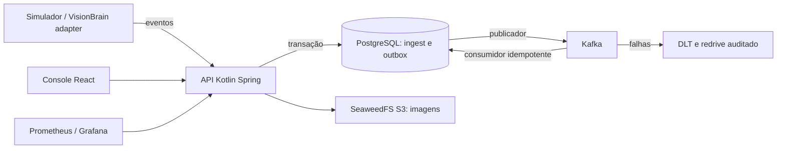

# FleetCam — laboratório de vídeo e saúde de dispositivos

FleetCam é uma prova de conceito local para estudar telemetria de câmeras de frota, Kafka, investigação de incidentes e evidências. O cenário é sintético; não há dados reais de clientes, integração comercial, detecção validada de direção perigosa ou uso de hardware físico.

**Estado: prova de conceito parcial.** O núcleo, simulador, console, evidência S3 e adapter de VisionBrain foram implementados; os marcos M0–M5 e todos os seus gates ainda não estão concluídos. Veja as [decisões e pendências](../decisions.md) e o [modelo de ameaças do laboratório](../threats.md). Não use esta instalação em produção.

## Arquitetura



O ciclo de vida inclui provisionamento, ativação, manutenção e desativação definitiva; dispositivos em manutenção ou desativados não geram alertas de conectividade. Heartbeats aceitos antes da desativação permanecem no histórico, mas não atualizam a projeção após a desativação.

O PostgreSQL registra evento e outbox juntos. A resposta HTTP 202 significa persistência local, não processamento concluído. Kafka opera com entrega pelo menos uma vez; reentregas idênticas não repetem o efeito no banco. O consumidor rejeita mensagens diferentes do evento persistido. Depois de tentativas limitadas, a mensagem vai para DLT; o redrive é explícito e auditado. Uma parada após publicação e antes da marcação do outbox pode causar nova publicação.

Conectividade usa o último heartbeat aceito, independentemente de atraso do consumidor. Após uma ausência de sinal, exige dois heartbeats aceitos para fechar o incidente e voltar a ONLINE. SD e captura são dimensões independentes: um campo ausente é UNKNOWN, não saudável por inferência de vídeo. Incidentes de SD, captura e ausência de heartbeat são hipóteses operacionais baseadas em sinais, não diagnósticos de causa raiz. Por padrão, dois aumentos consecutivos no contador abrem WRITE_ERROR e duas leituras estáveis o encerram; os limites de capacidade têm histerese de 10%/12% e esses parâmetros são configuráveis. Sessões de boot encerradas não podem sobrescrever o estado atual ao serem reenviadas. Para um boot ainda desconhecido, a ordenação entre boots depende do relógio do device; replays antigos podem parecer sinais recentes porque a conectividade usa o horário de aceite.

## Executar

Requisitos: Docker com Compose, internet para obter imagens e dependências e Python 3.10. Na pasta do projeto:

```powershell
docker compose up --build -d
py -3.10 simulator/fleet.py --scenario healthy --devices 20
```

Aguarde o primeiro build e a inicialização dos serviços. Abra o console em **http://localhost:8081** e informe a chave de laboratório `local-demo-key`. A API fica em `http://localhost:8080`; a chave `local-tenant-b-key` abre um segundo tenant isolado para teste; o Prometheus, em `http://localhost:9090`; o Grafana, em `http://localhost:3000` (`admin` / `fleetcam_local`). O Jaeger fica em `http://localhost:16686`. Todas as portas publicadas estão restritas a loopback. As credenciais são descartáveis e não devem ser reutilizadas.

```powershell
Invoke-RestMethod http://localhost:8080/api/v1/ops/overview -Headers @{'X-API-Key'='local-demo-key'}
docker compose logs -f api
docker compose stop
```

Os volumes de PostgreSQL e objetos são preservados ao parar. O Compose usa SeaweedFS como servidor local S3 compatível; o cliente de objetos usa o SDK MinIO. Não há dependência de conta paga.

## Simulação e verificação

A demonstração completa de laboratório pode ser iniciada com `powershell -ExecutionPolicy Bypass -File scripts/demo.ps1`; o padrão mantém o dispositivo simulado offline por 75 segundos e reinicia o Kafka do próprio Compose durante o teste de falha.

Os cenários disponíveis são `healthy`, `sd_failure`, `full_sd`, `duplicate_events`, `delayed_events`, `offline_reconnect`, `hard_brake` e `reboot_loop`. Use seed diferente para cada cenário. O simulador gera manifesto, ground truth, expectativas e spool em `simulator/output/`; `--resume` reenvia um spool pendente. Para manter a fila local durante uma janela controlada antes do envio, use `--scenario offline_reconnect --offline-seconds 90`. A janela padrão é zero e a desconexão é simulada pelo cliente, sem afetar a rede real.

```powershell
py -3.10 -m unittest discover -s simulator
py -3.10 -m unittest discover -s adapters
py -3.10 simulator/online_check.py
py -3.10 simulator/integration_check.py
py -3.10 simulator/validation_check.py
py -3.10 simulator/device_lookup_check.py
py -3.10 simulator/incident_check.py
py -3.10 simulator/connectivity_check.py
py -3.10 simulator/reboot_check.py
py -3.10 simulator/tenant_check.py
py -3.10 simulator/lifecycle_check.py
py -3.10 simulator/decommission_replay_check.py
py -3.10 simulator/tracing_check.py
py -3.10 simulator/evidence_check.py
py -3.10 simulator/dlt_check.py
py -3.10 simulator/redrive_check.py
py -3.10 simulator/fault_check.py
py -3.10 simulator/benchmark.py --count 30
```

Os testes de integração usam o Compose local. `fault_check.py` e `decommission_replay_check.py` param e reiniciam o Kafka deste projeto; `redrive_check.py` cria e remove uma falha temporária no banco de teste. Execute-os somente em ambiente de laboratório. Os testes executados e seus limites estão em [validação local](../validation.md), e os resultados da amostra medida estão em [benchmark](../benchmark.md); o [runbook](../runbook.md) descreve investigação e RCA sintético; [SLIs e SLOs propostos](../slo.md) não são metas comprovadas.

## Evidências

`POST /api/v1/evidence/uploads` solicita upload temporário para um evento existente. Após o PUT, `/api/v1/evidence/{id}/confirm` confere tamanho, SHA-256 e assinatura PNG/JPEG; somente então grava uma cópia verificada e marca AVAILABLE. `/access` fornece URL de leitura com validade de cinco minutos apenas para evidência confirmada e não expirada. A retenção padrão é de sete dias; a limpeza é periódica e tenta novamente se o armazenamento estiver indisponível. A verificação de assinatura não é antivírus nem valida origem ou conteúdo. O limite declarado de 10 MiB é conferido na confirmação, não imposto ao upload assinado.

## VisionBrain

O adapter `adapters/visionbrain.py` recebe o `VisionEvent` nativo em webhook local `http://127.0.0.1:8091`, guarda a fila em SQLite e envia o envelope à API. Configure `FLEETCAM_DEVICE`, `FLEETCAM_API_KEY`, `FLEETCAM_URL` opcional e `FLEETCAM_IMAGE_ORIGIN` (`SYNTHETIC` para o teste); o dispositivo deve estar provisionado. O spool é associado a um device e origem. O comando `py -3.10 adapters/visionbrain.py --import-spool CAMINHO_DO_SPOOL` importa registros pendentes e tenta enviá-los sem alterar o arquivo original; a fila local mantém os não entregues. Ele não autentica o webhook local. Para envio automático de snapshots informados no evento nativo, configure `FLEETCAM_SNAPSHOT_ROOT` com a pasta confiável que contém as imagens; caminhos fora dela não são lidos. O adapter persiste o estado de entrega e usa identidade estável para retentativas. Use apenas num ambiente confiável e alimente-o apenas com análises efetivamente realizadas.

Para anexar um snapshot explicitamente selecionado a um evento já aceito, configure `FLEETCAM_API_KEY` e execute `py -3.10 adapters/upload_snapshot.py --event-id UUID --file CAMINHO.png --origin SYNTHETIC` (ou `VISIONBRAIN_ANALYSIS` para uma imagem produzida nessa análise). O script solicita o upload, envia e confirma a integridade; a origem deve corresponder ao arquivo real.

O teste `adapters/visionbrain_check.py` verifica também o snapshot nativo e sua repetição idempotente. Ele depende do projeto vizinho VisionBrain e suas bibliotecas instaladas. Em PowerShell: `$env:PYTHONPATH=(Resolve-Path '..\VisionBrain\src').Path; py -3.10 adapters/visionbrain_check.py`. Ele analisa um quadro preto sintético pelas regras reais de qualidade; isso não é inferência de direção perigosa.

## Limites conhecidos

O isolamento foi testado com dois tenants e chaves compartilhadas de laboratório; não há autenticação por dispositivo, TLS, gestão corporativa de tenants e papéis, rate limiting, antivírus, histerese de todas as dimensões, garantias contra clock skew, vídeo contínuo, streaming, captura física, Testcontainers de crash do consumidor, SLO validado ou benchmark de carga representativo. O publicador do outbox foi projetado para uma única instância. O console cobre consultas principais, mas não todos os fluxos do escopo. O [contrato v1](../contract-v1.schema.json) documenta o formato; não é atualmente executado como validador JSON Schema. O workflow de CI está incluído, mas sua execução remota não foi comprovada localmente.

## Licença

Nenhuma licença foi declarada. Todos os direitos reservados até que o autor escolha uma licença.
