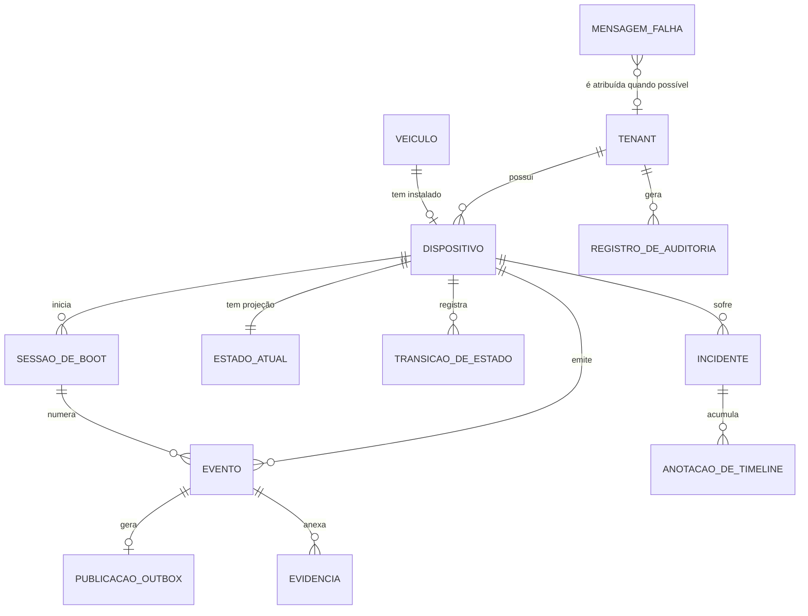

# Modelo conceitual — FleetCam

> Entidades do domínio operacional (telemetria de câmeras de frota), sem detalhes
> físicos. Laboratório de portfólio: tenants e dispositivos são simulados
> (`simulator/fleet.py`).

| Entidade | Significado | Tabela |
|---|---|---|
| Tenant | cliente (frota) isolado dos demais | coluna `tenant_id` (não há tabela de tenants — limite do laboratório) |
| Dispositivo | câmera instalada num veículo | `devices` |
| Veículo | atributo do dispositivo (`vehicle_id`), sem cadastro próprio | — |
| Sessão de boot | período entre reinicializações; reinicia a numeração de eventos | `device_boot_sessions` |
| Evento | telemetria recebida (heartbeat, estado do SD...) | `ingest_events` |
| Publicação (outbox) | intenção de publicar o evento no Kafka, gravada na mesma transação | `outbox` |
| Estado atual | projeção do último estado conhecido | `device_state` |
| Transição de estado | histórico de mudanças de armazenamento/gravação | `state_transitions` |
| Incidente | problema operacional aberto/fechado | `incidents` + `incident_timeline` |
| Evidência | snapshot/vídeo em armazenamento S3 com hash | `evidence` |
| Mensagem com falha | mensagem Kafka que o consumidor não processou | `dead_letters` |
| Auditoria | ação administrativa | `audit_log` |

## Regras de negócio que moldam o modelo

1. **Isolamento por tenant:** um dispositivo de um tenant nunca pode ser
   referenciado por evento/estado/incidente de outro.
2. **Idempotência na ingestão:** o mesmo evento (tenant, device, boot, sequência,
   tipo) só é aceito uma vez — dispositivos reenviam após falha de rede.
3. **Um incidente aberto por tipo e dispositivo:** heartbeats repetidos não abrem
   incidentes duplicados; depois de fechado, o histórico fica e um novo pode abrir.
4. **Publicação confiável:** evento aceito e intenção de publicar são gravados na
   mesma transação (padrão outbox).
5. **Evidência com cadeia de custódia:** hash SHA-256, tamanho limitado, retenção.
